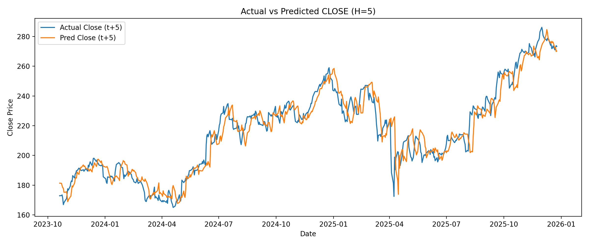

Stock Transformer Project — Local Setup Guide (Private)
Objective

Create a GitHub-based project, connect it to VS Code, set up a Python environment, install required packages, configure API keys, and prepare the pipeline for downloading historical stock price data from Alpha Vantage and Yahoo Finance.

1) Create a Repository on GitHub

GitHub → “+” → New repository

Repository name: stock-transformer-project

Add README ✅

License: MIT (optional but professional)

Create repository

2) Create Folder Structure on GitHub (Using .gitkeep)

Since GitHub does not track empty folders:

Add file → Create new file → data/raw/.gitkeep → Commit

Add file → Create new file → data/processed/.gitkeep → Commit

Add file → Create new file → notebooks/.gitkeep → Commit

3) Configure .gitignore

Purpose: prevent sensitive or heavy files from being pushed to GitHub.

Important entries:

.env

.venv/

__pycache__/

*.pyc

.ipynb_checkpoints/

data/raw/*.csv (optional)

4) Install Git on Windows

In PowerShell:

git --version

If Git is not installed:

Install Git for Windows

Run again:

git --version

A version number should be displayed.

5) Open the Project in VS Code

VS Code → File → Open Folder

Project path:
D:\lessons\season 4\code\stock-transformer-project

6) Create a Virtual Environment (venv) and Install Packages
Create venv
python -m venv .venv

Activate venv
.\.venv\Scripts\Activate.ps1

If an execution policy error occurs:

Set-ExecutionPolicy -Scope CurrentUser RemoteSigned

Then activate again.

Upgrade pip and install dependencies
python -m pip install --upgrade pip
pip install -r requirements.txt

7) Select Python Interpreter in VS Code

Ctrl + Shift + P

Python: Select Interpreter

Choose the interpreter inside .venv:

...\stock-transformer-project\.venv\Scripts\python.exe

Verification:

python -c "import sys; print(sys.executable)"

The output should point to .venv.

8) Create .env File and Configure Alpha Vantage API Key

Create a file named .env in the project root.

Content (single line only):

ALPHAVANTAGE_API_KEY=YOUR_REAL_KEY

Note: No other commands should be written inside .env.

Install dotenv:

pip install python-dotenv

Test:

python -c "from dotenv import load_dotenv; import os; load_dotenv(); print('OK' if os.getenv('ALPHAVANTAGE_API_KEY') else 'MISSING')"

9) Create src Folder and Code Files

Correct structure:

src/
  data_collection.py

Common mistake: creating a file named src instead of a folder.

10) Security Notes

.env must not be pushed to GitHub (included in .gitignore)

.venv must not be pushed to GitHub

Current Checklist Status

Repository created ✅

Project opened in VS Code ✅

Git installed ✅

.venv created and activated ✅

Packages installed ✅

.env and API key configured ✅

python-dotenv installed ✅

Interpreter set to .venv ✅

11) Writing the Alpha Vantage Data Collection Script

File created:

src/data_collection.py

Purpose of this script

Connect to Alpha Vantage API

Download daily stock price data

Convert JSON response into a Pandas DataFrame

Save raw data to data/raw/

Core logic

Load API key from .env

Send HTTP request to Alpha Vantage

Handle API errors (rate limit / subscription info)

Clean and format data

Save data as CSV

12) Run the Script and Download Data

Command (with .venv activated):

python src/data_collection.py

Successful output

Generated file:

data/raw/AAPL_daily_compact.csv

Terminal output:

Saved: data\raw\AAPL_daily_compact.csv
Shape: (100, 5)

Columns:

Open

High

Low

Close

Volume

Important note

Using Alpha Vantage free tier:

Only last 100 trading days available

outputsize=compact

Endpoint: TIME_SERIES_DAILY

13) Commit Changes to GitHub (Work Hours Tracking)

After successful execution:

git status
git add src/data_collection.py .gitignore
git commit -m "Fix Alpha Vantage free-tier usage and improve data collection output"
git push

Result

Changes saved on GitHub

Commit includes timestamp, author, and description

✅ This commit is considered valid evidence of work hours

14) Start EDA in Jupyter Notebook

Notebook created:

notebooks/02_eda.ipynb

EDA steps performed

Load raw CSV data

Convert date column to DateTime

Set Date as index

Perform initial data inspection

Data loading code
df = pd.read_csv("../data/raw/AAPL_daily_compact.csv",
                 parse_dates=["Unnamed: 0"])
df = df.rename(columns={"Unnamed: 0": "Date"})
df = df.set_index("Date")

15) Basic Feature Engineering (Important for Transformers)
15.1 Daily Returns
df["Return"] = df["Close"].pct_change()

Meaning:

Percentage change of today’s price compared to yesterday

One of the most important features in financial modeling

15.2 Rolling Window (Foundation for LSTM & Transformer)
df["MA_5"] = df["Close"].rolling(5).mean()

Meaning:

5-day moving average

Enables the model to learn temporal windows

15.3 Resampling (Change Time Frequency)
df.resample("W").mean()

Meaning:

Convert daily data to weekly

Reduce noise

Useful for long-term analysis

16) Save Notebook and Commit to GitHub
git add notebooks/02_eda.ipynb
git commit -m "Add EDA notebook: quality checks, returns, rolling features, resampling"
git push

Result

Notebook saved on GitHub

A concrete step toward thesis-quality and resume-ready project

17) Current Project Status

At this stage, the project includes:

✅ Professional GitHub repository

✅ Standard development environment

✅ Connection to real financial APIs

✅ Download of real market data

✅ EDA and basic feature engineering

✅ Full version control history

Adding Yahoo Finance as a 10-Year Historical Data Source
Package installation
pip install yfinance

Update requirements

Add yfinance to requirements.txt (preferably minimal)

Implementation

Add fetch_yahoo_daily(...) function to src/data_collection.py

Define 10-year time range:

start_date = "2015-01-01"
end_date   = "2026-01-01"   # end date is typically exclusive in yfinance

Output
data/raw/AAPL_daily_10y_yahoo.csv

Test
python src/data_collection.py

Expected:

~2700 rows

Date range: 2015 → present

18) Commit and Push Yahoo Finance Integration
git status
git add src/data_collection.py requirements.txt .gitignore
git commit -m "Add Yahoo Finance 10-year data source and keep Alpha compact pipeline"
git push

Work Log

2025-12-28

Implemented data collection pipeline using Alpha Vantage (free-tier, compact)

Added Yahoo Finance as a secondary source for 10-year historical price data

Verified data integrity and date ranges

Updated project setup documentation and requirements

Approximate effort: 4–5 hours
## Work Log – Time Series EDA (Yahoo Finance)

### Date
2026-01-16

### Summary
Performed a comprehensive exploratory data analysis (EDA) on the 10-year historical stock price dataset obtained from Yahoo Finance (AAPL). The focus was on ensuring data correctness, resolving multi-level CSV header issues, and preparing the dataset for time-series modeling.

### Tasks Completed
- Reloaded and validated the full 10-year Yahoo Finance dataset
- Fixed CSV parsing issues related to multi-level headers and unnamed columns
- Standardized the dataset schema to OHLCV format
- Verified datetime indexing, data types, and absence of missing values
- Conducted time-series EDA including:
  - Price trend analysis and non-stationarity assessment
  - Dual-axis visualization of price and trading volume
  - Log return computation and analysis
  - Rolling volatility analysis and identification of volatility clustering
- Identified and resolved unintended dataframe slicing affecting visualization range
- Structured EDA outputs to align with academic expectations for time-series analysis

### Outcome
The dataset is now fully validated and the EDA is complete and ready for academic submission. Results confirm non-stationarity in price levels, more stable behavior in log returns, and time-varying volatility, motivating the use of sequence-based models in subsequent stages.

### Estimated Effort
~4–6 hours
## Worklog — 2026-01-19

### Summary
- Updated Yahoo price dataset using yfinance to ensure recency and enable alignment with news sentiment timestamps.
- Built/validated an end-to-end analysis pipeline that merges numerical price features with daily aggregated news sentiment features.
- Generated reproducible artifacts (processed CSV + figure) for reporting/presentation.

### Changes Implemented
- Added/updated script: `src/update_price_yahoo.py`
  - Downloads full daily price history for AAPL via `yfinance`
  - Saves output to `data/raw/AAPL_daily_yahoo_latest.csv`
- Updated pipeline: `src/analysis_pipeline.py`
  - Loads price CSV and computes features (`log_return`, `vol_20`)
  - Fetches Alpha Vantage NEWS_SENTIMENT and converts JSON → DataFrame
  - Aggregates sentiment daily (`sentiment_mean`, `news_count`, `relevance_mean`)
  - Merges price + sentiment and saves:
    - `data/processed/AAPL_price_sentiment_features.csv`
    - `data/processed/AAPL_close_vs_sentiment.png`

### Notes / Current Status
- Data alignment issue identified: price data currently ends at 2026-01-16 while sentiment data spans 2026-01-17 to 2026-01-19.
- Next action: align news dates to the nearest business/trading day (e.g., previous business day) or update price coverage when available.

9) News Sentiment Pipeline (Alpha Vantage – Free Tier)
Objective

Extend the project by integrating news sentiment data from Alpha Vantage and preparing daily aggregated sentiment features that can be merged with stock price time series for downstream modeling (LSTM / Transformer).

19.1 Alpha Vantage NEWS_SENTIMENT Integration

A new script was implemented to fetch and process news sentiment data:

File:

src/sentiment_collection.py

API Endpoint:

function=NEWS_SENTIMENT

Source: Alpha Vantage (free tier)

Tickers processed:

AAPL

MSFT

GOOGL

AMZN

NVDA

19.2 Rate Limit Handling (Free Tier Safe)

Alpha Vantage free tier allows ~5 requests per minute.

Implemented safeguards:

13–15 seconds delay between requests

Exponential backoff on rate-limit responses

Automatic stop if daily quota is exceeded

Local caching to avoid repeated API calls

19.3 Sentiment Extraction Logic

For each news item:

Prefer ticker-specific sentiment (ticker_sentiment_score)

Fallback to overall sentiment (overall_sentiment_score) if ticker-level data is missing

Store the sentiment mode (ticker vs overall) for transparency

Captured fields:

time_published

title

source

sentiment_score

relevance_score

mode

19.4 Daily Aggregation (Model-Ready Features)

Raw intraday news sentiment is converted into daily features:

Aggregated per day:

sentiment_mean

sentiment_median

n_news (news volume per day)

This step aligns unstructured news data with daily stock prices.

19.5 Output Files

Generated files (cached locally):

data/processed/
├── AAPL_news_raw.csv
├── AAPL_news_daily.csv
├── MSFT_news_raw.csv
├── MSFT_news_daily.csv
├── GOOGL_news_raw.csv
├── GOOGL_news_daily.csv
├── AMZN_news_raw.csv
├── AMZN_news_daily.csv
├── NVDA_news_raw.csv
├── NVDA_news_daily.csv
└── summary.csv

summary.csv contains:

ticker

news_count

sentiment_mean

relevance_mean

19.6 Caching Strategy

Before calling the API, the script checks:

If *_news_raw.csv and *_news_daily.csv already exist
→ data is loaded from disk
→ API call is skipped

This makes the pipeline:

reproducible

API-efficient

safe for repeated experimentation

19.7 Reproducibility Notes

Requirements:

requests
pandas
python-dotenv

Environment variable required:

ALPHAVANTAGE_API_KEY

Execution (with .venv activated):

python src/sentiment_collection.py

19.8 Purpose in Thesis Context

This pipeline enables:

Empirical analysis of news sentiment impact on stock prices

Construction of hybrid models combining:

numerical price features

sentiment-derived exogenous variables

Direct alignment with academic literature on sentiment-driven market behavior

09.02.2026
## LSTM Stock Price Prediction – Setup & Progress Log

### Environment Setup
- Python 3.10 (required for TensorFlow compatibility)
- Virtual environment: `.venv_tf`
- Key libraries:
  - numpy
  - pandas
  - scikit-learn
  - tensorflow (keras backend)

### Data Preparation
- Loaded 10 years of daily stock prices (Yahoo Finance CSV)
- Cleaned and sorted data by date
- Used only `Close` price
- Applied MinMax scaling (fit on train only)
- Created sliding window sequences (lookback = 20)
- Time-series aware train/test split (80/20)

### Model Architecture
- Keras Sequential model
- Input shape: (lookback, 1)
- Single LSTM layer (50 units)
- Dense output layer (1)
- Optimizer: Adam
- Loss: Mean Squared Error (MSE)

### Training Strategy
- Validation split from training data
- EarlyStopping on validation loss
- No shuffling (time series integrity preserved)

### Current Status
- Model trains successfully
- Training and validation loss converge
- Test MSE computed on scaled data
- Next step: inverse scaling + RMSE/MAE in real price units

12.02.2026
Model Evaluation (Real-Scale Metrics)

Performed inverse scaling on predictions

Computed:

Test RMSE (USD)

Test MAE (USD)

Verified consistency between model.evaluate() and manual MSE calculation

Confirmed no data leakage in scaling or window creation

Visualization

Generated Actual vs Predicted (Test Set) plot

Generated Training vs Validation Loss curve

Saved plots to:

data/processed/
├── aapl_actual_vs_predicted.png
└── aapl_train_val_loss.png

These visual diagnostics confirm:

Stable convergence

No severe overfitting

Reasonable short-term prediction alignment

Engineering Improvements

Modularized pipeline:

load_prices()

prepare_lstm_data()

build_lstm_model()

evaluate_model()

plot_actual_vs_predicted()

Added reproducible output saving

Structured script for clean execution from CLI

Next Planned Steps

Add dropout / deeper LSTM architecture comparison

Introduce additional features (returns, rolling volatility)

Integrate daily sentiment features

Prepare baseline comparison (e.g., naive forecast)

### LSTM Regularization Experiment
- Added Dropout (0.2) after LSTM layer
- Reduced train–validation loss gap
- Slight improvement in test RMSE stability

## LSTM Price Forecasting (Price-only)

This project implements a **thesis-grade LSTM pipeline** for stock price forecasting
using OHLCV-derived features only.

### Key Features
- Multi-horizon forecasting (H=5, H=10)
- Log-return target with price reconstruction
- Walk-forward cross-validation
- No data leakage (train-only scaling)
- Bridge sequences for Val/Test
- Early stopping on business metric (RMSE in price space)

### Results
| Horizon | Test RMSE | MAPE | Directional Acc |
|--------|----------|------|-----------------|
| 5 days | ~8.8 USD | ~3%  | ~50% |
| 10 days| ~12.7 USD| ~4.5%| ~47% |

### Example Outputs

## Final Model
- Architecture: 2-layer LSTM (96 → 32) + Dropout
- Target: log-return of Close_{t+H}
- Selection: walk-forward CV (RMSE on reconstructed price)
- Horizons: 5-day, 10-day
- Outputs: metrics (JSON), plots (PNG)

## Current Results (AAPL)

- Horizons: 5-day, 10-day
- Model: LSTM (leakage-safe, no Close in X)
- Evaluation: time-based split (70/10/20)

See:
- `data/processed/` for plots
- `outputs/metrics/` for quantitative results
